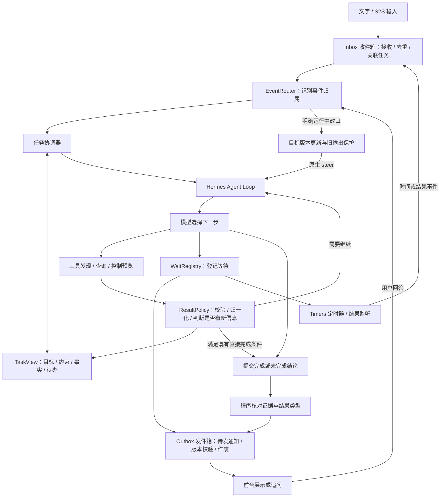

# 方案一：Demo Agent Loop 功能与架构优化

版本：v5，2026-11-15  
状态：第一版以及第15、16节已实现并验证；新增证据见[任务焦点与周期任务验收](focus-and-recurring-acceptance.md)；当前实现与证据见 [方案一验收记录](plan-one-acceptance.md)。**方案二仍未决策，不纳入本轮实施。**

## 1. 目标与范围

在单实例 Demo 中完善“接收任务 → 准备上下文 → 选择工具 → 观察结果 → 继续/等待/结束 → 反馈”的功能闭环，减少重复发现、无效模型往返和错误任务关联。

用户可验证的目标：

- 明确设置指令保持轻路径，直接生成正确参数。
- 相对调节先取得必要事实，再生成目标值。
- 工具不足时按需补搜；失败后依据新信息继续，而不是重复尝试。
- 回答、运行中改口、排队追加、闲聊、新需求和取消有明确区别。
- 等待用户、等待时间和等待外部结果后，都能继续原业务目标。
- 旧目标的参数不能完成新目标，最终结果及反馈准确可见。

保留 Hermes、现有模型、配置化工具及已有 SQLite 任务记录。车控仍只生成并校验结构，查询仍返回模拟数据；不连接车辆、不新增虚拟车辆状态模拟器。

本轮不处理服务重启、节点切换、多实例部署、分布式租约、生产级持久化调度或开机自启。旧生产恢复文档仅作历史参考。

## 2. 能力状态：不要把已实现、已验证和待实现混在一起

| 能力 | 当前状态 | 本方案动作 |
| --- | --- | --- |
| 明确控制的精简候选、相关查询预加载、中文全局搜索 | 已实现 | 保留轻路径，优化已知定义复用与召回评测 |
| 参数/版本/前置条件校验、成功结果类型自动分类 | 已实现 | 保留，不为确定字段再问模型 |
| 文字与 S2S 追问接续、多待答任务选择 | 原版本已实现并实测 | 待按第15节改为当前任务焦点优先，保留真正歧义时的选择 |
| 明确取消短句、当前任务焦点、历史指代、五分钟追问过期 | 已实现并验证 | 文字与 S2S 使用同一套任务归属和状态校验 |
| 每日/每周周期任务 | 已实现，另支持至少一分钟的间隔计划 | 见第16节；计划与每次执行分开保存 |
| 工具过程、输入/结果/耗时、S2S 忙闲播报 | 已实现 | 补齐修改、等待和继续的状态展示 |
| 运行中改口，原 task / 原 run 继续 | **已接入文字和 S2S，真实模型验证通过** | 保留旧参数、旧回执和旧播报保护 |
| 任意工具、任意自然语言改口 | 未验证 | 首版支持明确空调目标温度及分区；歧义先暂停澄清 |
| Hermes 原生 clarify | 文档/源码已核对，功能未验证 | 先做兼容验证，有收益才替换现有追问适配 |
| 一次延时、等待异步结果、有限次跟进 | 定时接续已实现；外部结果测试适配器已验证 | 同任务继续，等待不占用模型；不接真实车辆异步执行 |
| 无进展识别、输入类型与状态流统一 | 已实现并有边界测试 | 按实际业务事实识别重复失败，统一 Inbox 与等待事件 |
| 独立子任务并发 | 方案二草案，未决策 | 仅保留接口衔接，不实施拆分或并发默认值 |

## 3. 功能结构：只保留一个 Hermes 循环

**收件箱（Inbox）、定时器（Timers）、发件箱（Outbox）仍是方案一的核心组成，不因采用 EventRouter 等实现名称而省略。** Demo 使用现有本地状态和进程内调度，不要求独立消息服务。

| 组件 | 职责 | 本轮改口实施范围 |
| --- | --- | --- |
| 收件箱 Inbox | 接收事件、去重、关联 task 与 revision；运行中改口优先进入目标保护，普通补充按归属处理 | loop_inbox 接收新请求、回答、改口、取消、追加及到期/外部结果事件；task_changes 保存改口约束；消息标识去重和轮次检查 |
| 定时器 Timers | 登记到点事件，到时送回收件箱；等待时不占用模型 | 已实现一次延时和进程内到期调度；外部结果采用回调测试适配器，不轮询模型 |
| 发件箱 Outbox | 排队发送追问与结果；发送前核对有效轮次，改口时作废旧通知和仍待播放的旧音频 | 扩展现有 events 通知队列和 S2S 播放门控 |

下面四组函数是上述功能的内部职责划分，不要求拆成四个服务：

- **EventRouter**：判断输入属于哪个任务、哪一种事件，不执行业务工具。
- **TaskView**：组织原目标、当前有效约束、已知工具和结果引用，不复制完整聊天历史。
- **WaitRegistry**：记录具体等待对象、触发条件和继续方式。
- **ResultPolicy**：复用现有校验与分类，补充无进展和反馈策略。

Hermes 继续维护完整 transcript、调用模型及分发工具。模型负责需要语义判断的下一步；明确状态转换、类型推导和预算检查由程序处理。不得为每轮增加固定的规划、反思或总结模型调用。

## 4. 六项优化总览

| 优先级 | 优化点 | 具体内容 | 验收重点 |
| --- | --- | --- | --- |
| P0 | 单一循环与简短上下文 | Hermes 管完整历史，TaskView 只提供业务事实和变化 | 无第二套独立更新的 transcript；简单请求输入不膨胀 |
| P0 | 输入事件明确分类 | 回答、改口、排队追加、闲聊、新需求、取消分别处理 | “全部”不新建任务，“改成21”不当闲聊，普通插话不取消任务 |
| P0 | 正式接入运行中改口 | 原生 steer 配合目标版本、旧参数/回执检查及监控适配 | 同 task 继续，旧23度不能完成新21度目标 |
| P1 | 统一等待语义 | 分开 user_answer、timer、external_result；由适配器负责继续 | 等待不误报完成，回填不串任务/串调用 |
| P1 | 失败分类与无进展控制 | 确定错误由程序处理；业务失败按缺失事实补查；限制无新信息的重复 | 不无限重试，也不把合理等待当失败 |
| P1 | 单一过程流与适时反馈 | 区分模型轮次、工具结果、任务完成和语音播放 | 不重复通知，不为过程文案增加模型调用 |

工具发现和定时继续的具体优化分别见第5、8节；原生改口的正式接入要求见第7节。

## 5. TaskView 与工具上下文优化

### 5.1 谁是数据来源

| 内容 | 来源与用途 |
| --- | --- |
| 原始目标 | 用户第一次提出的目标，保留历史，不因改口覆盖掉 |
| 当前有效目标及确认约束 | 已接受的回答/改口；明确哪些字段仍沿用原值 |
| 稳定任务身份、当前处理轮次 | 关联原工作、拒绝旧输出，不把目标文本本身当任务身份 |
| 已知工具引用及版本 | 已有候选、搜索结果、实际读取过的定义 |
| 事实引用 | 有来源的工具回执及观察时点，不是模型猜测 |
| 控制预览 | 已生成的调用结构，标识当前有效还是被替代 |
| 已完成、未完成与等待项 | 支持下一步决策，不把一次工具成功等同整体完成 |
| 最近失败及尝试 | 用于区分新证据与重复尝试 |

已有任务字段和回执优先做投影，开始、回答、改口或等待结束时传入必要变化。只有实测显示上下文选择/压缩存在问题，才评估 Hermes Context Engine 扩展；不为业务字段替换现有压缩器。

当前 profile 是固定模拟快照。“生成设为21度的结构”不能把观测温度自动改成21度；事实、预览、目标三个概念保持分开。

### 5.2 工具定义与事实不要重复获取

- 明确单目标保留精简控制定义，不无条件带车书/车况。
- 相对调节可带相关查询；工具不足时直接全局检索，定义足够则直接调用。
- 已知 Schema 按目录/工具版本复用，不重新浏览根目录或反复 describe。
- 查询回执只在适用范围和有效期内复用；同一接口的旧读数不能自动代表新观察。
- 候选仍是线索，不限制后续搜索，也不证明已经满足全部目标。

不要为“统一工具检索”让简单指令必经一次模型搜索。检索算法仍先使用本地方案，用换说法样本评估漏召回，再决定是否增加向量能力。

## 6. EventRouter：把输入关联与行为分清

| 事件 | 例子 | 处理 |
| --- | --- | --- |
| new_request | “打开天窗” | 创建新任务 |
| answer_question | “全部”回答分区 | 校验待答对象，在原任务继续 |
| revise_goal | “改成21度” | 关联原任务，进入第7节的目标修改流程 |
| append_followup | “做完再给我详细参数” | 当前工作结束后处理附加输入，不立即替换当前目标 |
| chat | “谢谢” | 前台对话，不自动产生/修改业务任务 |
| cancel | “取消刚才的设置” | 停止指定任务，后续输出不能再变为成功 |
| timer_due | 登记的时间到了 | 继续原等待任务 |
| external_result_ready | 对应异步结果就绪 | 按等待/调用引用回填 |

事件至少明确任务归属、类型、输入内容、接收时点与处理轮次。新增路由规则见第15节：先识别动作及明确指代，再使用会话任务焦点；文字与 S2S 共用后端校验，不新增每条消息必经的路由大模型。

多个挂起任务不再自动等于歧义：有明确焦点时，“全部”“主驾”“算了”默认关联当前未结束任务。只有明确指代不唯一、焦点缺失或动作不适用时才澄清；不能把短句随意塞给更旧任务。轻量事件标识解决 Demo 中的重复提交即可，不扩展为生产消息中间件。

## 7. 运行中改口：纳入已验证方案

### 7.1 已验证的事实

在固定全部分区的“设为23度，运行中改为21度”测试中，三个时点各测两次：模型生成中、旧调用提交前、旧预览保存后但结论提交前。六次受保护测试全部在原 task、原 run 中完成为21度，改口后没有接受旧23度回执，每次只产生一条完成通知。

两个对照说明了必要改动：

- 只调用原生 steer，接口 accepted 后，途中的旧23度调用仍可能被接受。
- 更新本地 revision、但沿用原 TaskManager 监控器，会因轮次变化停止远端 run，无法顺利接续。

上述是先前隔离验证的结论；正式接入后的文字、S2S 回调和真实千问验证见本版验收记录。首版仍不证明任意自然语言修改都已可靠解析。原始对照证据见 [原生 steer 验证报告](hermes-native-steer-verification.md)。

### 7.2 正式接入流程

1. **明确修改对象。** 前台产生原任务的修改事件；保留原始文本，形成当前有效目标及可校验约束。首版优先覆盖已验证的明确温度变更；无法可靠绑定对象/字段时先澄清。
2. **先建立本地保护。** 记录修改、更新轮次，旧轮次的控制与结论不再用于当前目标；已有预览保留历史、标记被替代。
3. **向原 run 发送 steer。** 携带新目标和当前任务上下文。正常路径继续原 task、原会话、原 run。
4. **区分接收与完成。** 本地已记录、Hermes 已接受、模型已生成新参数、当前目标已完成分别展示。accepted 不作为新目标已执行的证明。
5. **验证新输出。** 新调用必须符合当前轮次与已确认修改约束；不把模型生成的23直接改写成21。旧控制回执不能通过再次引用成为新目标的完成证据。
6. **提交当前结果。** 继续使用现有回执校验和程序自动分类，产生一次当前结果通知。

具体业务字段仍来自工具配置/Schema 和任务上下文，不把所有车控参数硬编码进 S2S system prompt。实验中的温度约束只是一个已验证例子，正式接入还要完成输入解析与绑定。

`revise_goal` 的最小载荷建议包括：关联任务、change_id、预期旧轮次、用户修改原文、新有效目标、已确认约束。接收时点和处理结果由程序记录。相同修改事件不重复增加轮次；约束尚不明确时先澄清，不能把“模型可能理解了”当成已经完成结构化绑定。

首版可先提供明确的任务修改入口，再接入 S2S 自然语言改口；两者调用同一修改处理函数。不得把实验中的固定空调字段/数值直接当成通用自然语言解析器。

### 7.3 必须同时接入的四项保护

| 位置 | 要改的行为 |
| --- | --- |
| 任务服务 | 保留原始目标，维护有效目标及处理轮次；身份不能依赖目标字符串相等 |
| 监控器 | 允许已登记的同 run 改口继续；不能因任何 revision 变化一概 stop，也不能取消所有轮次检查 |
| 工具与结论入口 | 拒绝旧轮次调用、新轮次里的旧目标参数，以及被替代控制回执 |
| 完成绑定与前台 | 按稳定任务/运行关系识别当前结果；显示修改进展，不把旧成功用于新目标 |

### 7.4 边界与失败处理

- **旧预览已生成、任务未终结**：保留旧记录，但继续生成新目标；不能说旧记录从未存在。
- **任务已完成**：建立关联的新请求，沿用明确对象/分区，不重写旧完成结果。
- **原生 steer 明确不接受**：保持新目标待处理，不能自动退回执行旧目标。可结束当前 run，再在原业务 task、原会话上继续；该降级路径还需正式测试。
- **发送结果未确认**：不宣称已改成功、不恢复旧参数通行；先核对当前运行及已到达的新结果，再决定重试或提示。
- **明确要改但修改内容有歧义**：先阻止旧目标继续提交控制并追问，不能一边按旧目标完成、一边询问新目标。
- **用户取消**：取消优先于继续，迟到的新旧结果都不能重开已取消任务。
- **连续改口/重复修改事件**：作为正式接入的新增验收；本次隔离验证没有覆盖。旧版本永远不能覆盖较新的已确认目标。

“改口生效”的保护边界是应用接受并登记修改之后；不能承诺从用户刚开始说话起就撤回一切已开始工作。当前只生成预览，不涉及真实设备动作撤销。

## 8. WaitRegistry：三种等待分开实现

| 类型 | 等待对象 | 继续时的行为 |
| --- | --- | --- |
| user_answer | 一个明确问题的回答 | 校验问题、任务与轮次，继续原目标 |
| timer | 尚未发生的时间点 | 到点推进下一步；此时业务查询可能尚未发起 |
| external_result | 已经发起的异步调用结果 | 按原调用/结果引用回填，不串到另一项等待 |

WaitRecord 至少包含关联任务、轮次、wait_id、类型、预期输入或结果引用、触发条件、接续后端、状态和预算。等待不是成功，也不是异常。

### 8.1 用户等待

现行规则：每次进入“等待用户补充”后五分钟仍无有效回答，转为过期终态。已按第15节实现。该规则不适用于正常执行、一次定时等待或整个周期计划。

保留已经实测的应用层追问接续。Hermes 原生 clarify 仍需验证：原生控制请求的关联方式、等待是否占运行额度、超时如何计时、取消行为，以及与现有任务轮次的兼容。

原生接口存在不代表当前自定义追问可以直接调用它；只有验证显示明确收益时才替换现有路径。

### 8.2 一次时间等待

首条场景是“收到请求后10秒查询空调温度”：登记等待 → 退出模型空转 → 到期事件 → 原任务查询 → 反馈。

程序确定时间基准；如果规划花费了一部分时间，不能到真正调等待工具时再额外增加完整十秒。使用进程内定时器，不在当前超时为10秒的车辆 MCP 工具中长时间 sleep。第一版已支持一次延时与有限跟进；每日/每周周期能力已按第16节实现。

### 8.3 外部结果等待

先定义 pending/done/failed 与结果引用，再用独立测试替身验证。现有模拟车辆工具立即返回结果，不能凭空称为“设备执行中”，也不新增虚拟车辆状态模拟器。

等待采用原生暂停还是应用层结束本次运行后继续，由适配器决定；不同框架的 resume 语义不可直接混用。监控 Hermes 自身的运行状态属于程序职责，不能让 Agent 定时查询自己是否完成。

## 9. ResultPolicy：区分失败、无进展和完成

| 情况 | 处理规则 |
| --- | --- |
| 确定的结果类型或字段 | 复用现有程序推导，不再问模型修正标签 |
| 参数不合 Schema | 返回具体缺失/冲突；确有必要才让模型修正或追问，不能擅自改变用户目标值 |
| 能力不支持、条件不满足 | 按缺失事实补查；证据足够就解释结束，不固定走“车况→车书→再试” |
| 暂时性服务错误 | 程序按有限重试规则处理，不让模型反复决定网络重试 |
| 正常等待 | 等关联事件，不作为失败或提前完成 |
| 相同动作、参数、事实下重复失败 | 判定无进展，停止重复尝试或澄清 |

新回执 ID 或新时间戳不代表出现新业务事实。无进展判断使用有意义的事实值、失败原因与目标版本；用户确实修改约束或取得新信息时才重新评估。

有限的等待轮询单独计数，不因多次 pending 误触发普通错误循环策略。模型轮数、工具调用及跟进次数都有边界，避免循环无限继续。

仍由 Agent 判断整个用户目标是否完成并提交证据，程序核对结果类别与有效性。一个工具成功、一个 run 结束和业务任务完成不能互相替代。

## 10. 统一过程与反馈

过程流区分：模型请求、工具返回、问题提出、修改已记录、修改已送达、新参数生成、进入等待、继续处理、任务完成和音频播放结束。

- 页面显示真实操作、参数、结果、耗时，以及旧预览被替代的状态。
- S2S 仅在有意义的状态变化和合适时机反馈，不朗读所有过程日志。
- 过程文案从事件与结果生成，不另加总结模型。
- UI 过程事件与后台通知不能重新成为模型的新用户指令。
- 新开启语音继续保持静默同步，不能自动播报旧成功结果。
- 待答、已受理、等待时间/工具和最终完成分别呈现。

这里关注 Demo 的正常交互，不引入生产级消息投递协议。

## 11. 更新后的实施顺序

| 阶段 | 工作 | 完成标志 |
| --- | --- | --- |
| A | 定义最小 TaskEvent、TaskView、WaitRecord；明确字段归属与状态 | 原目标/有效目标、问题/改口/等待不混用，不复制 Hermes transcript |
| B | **将已验证 steer 适配正式接入文字、S2S 与任务服务** | 新目标正确、旧参数和回执失效、原任务继续、取消与完成边界正确 |
| C | 单独验证原生 clarify，再决定保留或替换现有追问后端 | 有可观测收益且不破坏现有“全部”接续；不把重做追问当成前提 |
| D | 实现一次定时继续，再验证外部异步结果测试替身 | 等待期间无模型空转，到期/结果到达继续原任务 |
| E | 收敛无进展与反馈策略，交错对照用例 | 降低多余调用，正确率不退化，简单指令不被无条件加流程 |

方案二继续未决。这里不实施子任务拆分、并发执行或父任务汇总，也不预先批准其并发默认值。

## 12. 验收清单

| 用例 | 关键断言 |
| --- | --- |
| 全部分区设23度 | 正确控制结构；保留轻路径，无额外路由/规划模型 |
| 空调加一度 | 先取得模拟事实，再生成目标；不重复找已知工具 |
| 未配备空气悬架 | 有依据说明，不能无限重复相同控制 |
| 分区追问后回复“全部” | 同 task、原温度不丢，语音/文字均正确关联 |
| 运行中“23改21”三个时点 | 分别验证模型生成中、旧调用前、旧预览后；当前结果只引用21 |
| 新轮次仍提交23或引用旧23回执 | 两者都拒绝，不改写参数，不误报完成 |
| steer 被拒绝或尚未确认 | 不退回旧目标，不伪报已应用；降级行为可见 |
| 23改21再改22 | 以最新已确认目标为准，不被迟到结果覆盖；属于正式接入新增测试 |
| 原任务完成后才修改 | 新建关联请求，旧结果保留 |
| “谢谢”、闲聊与排队追加 | 不误取消、不误修改目标，不混同时间跟进 |
| 10秒后查温度 | 等待期间零模型空转；按约定时间基准继续原任务 |
| 异步测试 pending→done | 结果匹配原等待，检查次数有限 |
| 取消等待/改口中的任务 | 后续触发或回包不能重开任务 |
| 相同错误反复返回 | 能明确停止/澄清，不把新ID当作新信息 |

记录正确率、模型请求数、必要/多余工具调用、候选输入量、改口接收至正确新结果的时长、等待期间模型调用数和用户反馈次数。时间测试需多次、交错对照，不能把小样本远端波动当成框架收益。

## 13. 依据与实施状态

- [开源实现对照](demo-agent-loop-practice-review.md)：Hermes、LangGraph、Pydantic AI、Pi 的机制与可借鉴边界。
- [原生 steer 隔离验证](hermes-native-steer-verification.md)：六次受保护用例通过，裸用接口与原监控器的负向对照，以及尚未验证的范围。
- [工具发现优化](tool-discovery-design.md)、[结论自动分类](result-classification-design.md)：当前已实现能力，继续复用。

文章中的事件、时间触发、记忆、权限和输出管理，在 Demo 中分别落实为事件入口、进程内定时器、简短业务上下文、现有工具约束及前台反馈，不扩展生产部署范围。[文章](https://claude.com/resources/articles/building-always-on-agents)

**本文件是合并后的主方案。steer 已正式接入文字和 S2S，原生 clarify 保留为可选后续研究；一次定时继续已实现，外部结果等待以测试适配器验证，不代表已接入真实车辆异步执行。**

## 14. 第一版实施补充

- Inbox 已使用 `loop_inbox` 记录输入类型、关联任务、轮次、载荷、接收与处理状态；S2S/文字共用任务服务。定时和外部完成事件同事务入箱。闲聊在前台处理，不驱动车辆任务。
- TaskView 保留有效目标、约束、工具引用与回执引用。Hermes 仍管理 transcript，不另加一轮摘要模型。
- Outbox 复用 `events`，通知带 task_revision。改口作废旧通知；S2S 清理旧待播音频、旧通知上下文，并拦截晚到的音频/文字，包括 response.created 晚到的边界。
- WaitRegistry 的 user_answer 由已持久化 question 状态投影；timer/external_result 存于 loop_waits。等待期间停止原 run，不让模型空转；到期或匹配结果继续原 task，明确增加轮次。
- 同轮次相同成功控制参数复用原回执；同 call_id 改参数仍拒绝。连续三次相同失败/空检索且没有新增事实时暂停追问。只有新业务事实可重置无进展计数。
- 对明确的空调绝对温度，程序检查用户确认的分区与目标值。模型不能猜“全部”，也不能把用户目标擅自改成另一个合法值；不合法 Schema 仍先返回参数错误。
- 完成后追加按原任务排队，形成关联请求；不拆分原目标，不引入方案二的子任务并发。明确请求原任务参数时，可直接读取已校验回执回答。
- 首版不承诺任意自然语言改口都能解析。非明确单项温度修改进入澄清，不能盲目让旧控制继续。

原生 clarify 尚未替换应用追问：当前 MCP 问题不是 Hermes 的原生控制请求，直接调用其 clarify 接口不具备匹配的 request_id / execution_generation。既有同任务追问链路作为本次验收对象；不把改造追问后端作为本版完成的前提。

## 15. 当前任务焦点、明确取消与五分钟过期（已实现）

本节记录已实现的交互决策；本节采用独立新增验收，不借用第一版结果代替验证。

### 15.1 会话焦点与任务归属

一个业务目标对应一个任务，任务可经历多次追问及多轮 Hermes 运行。会话可以保留多个未结束任务，但维护一个当前任务焦点。

1. 用户明确指代或在页面选择任务时，优先绑定该任务；文字与页面选择相互冲突时确认，不静默覆盖。
2. 没有明确指代时，使用最近由用户发起或明确交互的未结束任务。“全部”“主驾”回答它的当前问题，“算了”取消它。
3. 后台轮询、工具结果、播报和历史任务进度更新不能改变焦点；不能用 tasks.updated 代替用户交互顺序。
4. “之前那个开车窗的任务”按用户所属会话的任务目标/对象定位；找不到或匹配到多个时澄清。
5. 当前任务已结束或无适用追问时，不悄悄回退到更旧的挂起任务。“全部”不能当作全局选择，也不能成为新车辆目标。
6. 明确指出已结束任务时，可以查看历史或基于它创建关联新请求，不能重新打开原任务修改结果。

最小焦点记录包含会话、任务引用、最近用户交互事件及顺序。明确指向过往任务后的交互可更新焦点。只记录业务关联，不复制模型 transcript。

### 15.2 先识别动作，再执行

| 用户输入 | 目标归属 | 动作 |
| --- | --- | --- |
| 打开车窗 | 新需求 | 创建任务并设为焦点 |
| 全部 / 主驾 | 当前任务的待答问题 | 补充原任务并继续 |
| 算了 / 不用了 / 取消这个任务 | 明确指定或当前未结束任务 | 直接取消，不把它当答案交回 Hermes |
| 改成21度 | 明确指定或当前可修改任务 | 进入现有改口保护链 |
| 之前开车窗那个，不用了 | 明确历史指代 | 定位后取消；终态不可重开 |
| 不用全部，主驾就好 | 当前待答问题 | 参数修正，不因出现“不用”就误取消 |
| 别取消 / 不是说取消 | 当前语境 | 不识别为取消指令 |
| 谢谢 / 闲聊 | 会话 | 不创建或改变车辆任务 |

取消动作进入已有取消入口、记录 Inbox 取消事件，作废旧追问及相关待播内容，拒绝迟到回答/回执，不启动新模型轮。S2S 判断和文字入口使用相同的归属/有效性规则；即使语音误选回答入口，后端也应识别明确取消并纠正分派。

### 15.3 五分钟追问期限

- 从当前问题生成并进入“等待补充”开始计时五分钟；该期限只作用于等待用户回答，不是任务总寿命。
- 到期自动进入 `expired` 终态，结束原因明确为等待补充超时，保留历史；与用户主动取消、正常完成分开显示。
- 后台进度、重复投递、闲聊不刷新期限。有效回答接续后停止本次计时；如果后续产生新的问题，为新问题重新计时。
- 检查过期和提交回答必须共同校验任务、轮次、问题及截止时间，避免先过期后又被迟到回答重开。
- 过期后清除焦点/待答绑定，作废旧问题通知和待播音频；不能继续播报旧追问或完成成功。
- 迟到回答说明原任务已过期；重新办理需要新请求，不静默恢复。
- 运行代码启用时，历史已超五分钟的待答任务同样过期；不批量朗读历史过期提示。
- 过期不触发原任务“完成后追加”的自动执行，也不能误取消周期计划本身。

页面显示“处理中 / 等待补充 / 已完成 / 已取消 / 已过期”。完成后的入口建议改名“基于此新建任务”，明确属于新请求。五分钟是用户已确认值；不新增后台开机启动或生产恢复机制。

### 15.4 新增验收（已执行，见新增验收记录）

| 场景 | 断言 |
| --- | --- |
| 追问哪个车窗，回答算了 | 原任务取消，0新增任务、0恢复模型请求 |
| 旧车窗与新空调都挂起，回答全部 | 关联最新用户焦点的空调问题，不要求无意义选择 |
| 旧任务后台产生新进度 | 不抢走当前焦点 |
| 之前开车窗那个，取消 | 只取消明确指定的车窗任务 |
| 没有有效焦点，回答主驾 | 澄清，不自动选择旧任务或创建“主驾”任务 |
| 不用全部，主驾就好 / 别取消 | 不触发取消 |
| 五分钟内回答 / 到期后回答 | 前者原任务继续，后者不可恢复已过期任务 |
| 回答与到期同时发生 | 只有一个有效状态转换，无重复控制/通知 |
| 新问题 / 重复问题通知 / 闲聊 | 只有真正的新问题建立新期限 |
| 过期时旧音频仍排队或返回 | 丢弃相关旧内容，不影响其他任务的正常播报 |
| 文字、S2S 相同语义 | 目标关联、取消和过期行为一致 |

## 16. 参考 Meta Muse 的周期任务扩展（Demo 已实现）

参考的是 Meta 的个人 Agent 产品 Muse。其公开产品设计描述了长会话、目标跟进、按日程和相关事件继续工作，以及只在有意义的新结果或需要输入时通知用户。公开产品行为可作对照，不能据此声称我们知道或复刻了其内部调度实现。[官方产品设计](https://muse.ai/blog/how-we-designed-muse)

### 16.1 对本项目的启发

| 体验方向 | 本项目对应能力 | 状态 |
| --- | --- | --- |
| 自然交互、持续上下文 | 当前焦点、回答/取消/改口、明确历史指代 | 已实现 |
| 后台持续推进 | Hermes loop、失败补查、等待与继续 | 第一版已实现部分能力 |
| 按日程周期工作 | 每日/每周计划、到期触发独立执行记录 | 已实现，支持查看/修改/暂停/恢复/取消 |
| 选择合适时机反馈 | Outbox、忙闲门控、旧结果作废；后续评估仅变化时通知 | 第一版已实现基础，通知策略待扩展 |
| 目标与活动可查看 | 任务卡片/过程记录；周期计划及每次执行历史 | 桌面已有周期计划视图，手机独立设计尚未实现 |
| 长期偏好与记忆 | 可查看、修正、遗忘的个人偏好 | 产品参考方向，未据此批准实现 |

此处不自动扩展到浏览器代办、购物、虚拟机、跨应用接入或方案二并发拆分。

### 16.2 为什么需要单独细化周期设计

一次延时是“这次任务等一会儿继续”；周期任务是“长期保留一条计划，每次触发产生一次执行”。两者的生命周期、取消范围和历史记录不同，不能靠在原任务里无限 sleep 或不断重新询问模型实现。

本次周期实现采用以下结构：

- 计划：目标、频率、当地时间/时区、启停状态、下一次触发、通知规则。
- 单次执行：所属计划、计划触发时点、独立任务状态和结果；一次失败或追问过期不等于整条计划结束。
- 触发链：定时器产生到期事件 → Inbox 去重和关联 → 创建本次业务任务 → Hermes 处理 → Outbox 返回有效结果。
- 管理操作：创建、查看、修改、暂停、恢复、删除；区分“取消这一次”和“以后都不要再做”。
- 正确性：重复到期事件去重；同一计划上次尚未结束时跳过本次触发，不排队；错过触发时记录原因并通知；新计划版本不能被旧事件重新执行。
- 交互：每天早上缺少具体时间时追问；不得把不完整表达默认为某个固定时间。计划创建前显示理解后的频率与任务目标。
- 范围：每日/每周先做功能闭环，车辆工具仍为模拟；不引入生产部署和节点恢复议题。

触发时间、时区、暂停/恢复、取消澄清和错过触发通知已按第16.3节确认；同一计划上次未结束则跳过、暂停时停止当前执行也已确认；常规执行结果沿用任务通知，跳过/错过原因单独通知并去重。实际用户计划由用户创建，验收使用隔离环境或新建测试会话，测试后取消计划。五分钟规则仅结束一次执行中的用户追问，不删除或停用整条周期计划。

### 16.3 周期任务已确认的交互规则（2026-11-15）

| 项目 | 已确认行为 |
| --- | --- |
| 触发时间 | 用户用语音指定希望执行的时间和频率，文字入口采用相同语义；不预设固定早晨时间。时间/频率不足以确定时追问 |
| 时区 | 按服务运行环境的当地时区解释与展示；使用明确的时区信息计算下一次触发，不仅保存固定UTC偏移 |
| 暂停 | 保留计划内容，阻止后续及尚未开始的触发，同时停止当前正在执行的一次；已登记的待触发事件不得在暂停后启动 |
| 恢复 | 支持恢复计划，重新计算后续触发时间；不补跑暂停期间积压次数，也不自动恢复已停止的那次执行 |
| 取消 | 指令未明确范围时追问“只取消这一次，还是取消整个计划？”；范围已明确时直接按明确范围处理，不重复询问 |
| 取消一次 | 只取消指定的一次执行/触发，后续周期仍保留；无法确定是哪一次时先定位 |
| 取消整个计划 | 停止未来触发，保留既有执行记录；已经发生的结果不能当作被撤销 |
| 上次未结束 | 同一计划已有未结束执行（含等待用户回答/外部结果）时，跳过本次触发并记录原因；不并发新开、不排队，不影响其他独立计划 |
| 错过触发 | 记录本次错过，说明已知原因并告知用户；不能伪报完成。不擅自补跑，用户需要补做时另行明确安排 |

原因说明以实际观测为依据，无法确认根因时说明未确认，不编造原因。通知继续通过 Outbox 去重并遵守 S2S 忙闲门控。

暂停的停止边界：先将计划设为暂停并使未开始的到期事件失效，再停止当前执行；等待中的执行也结束本次等待。迟到工具结果、用户回答和旧成功通知不能让已停止的执行恢复或被宣布成功。已生成的历史结果保留；停止不表示撤销已经发生的操作。当前 Demo 仍无真实车辆操作。

新增验收：同一计划触发重叠只记录跳过；等待回答也占用该计划的一次执行；暂停与到期并发时不启动新执行；暂停停止当前执行并清理旧通知；恢复只安排之后的触发；旧回包和重复到期事件不能重开已停止的执行。

实现采用：取消整个计划与暂停一样停止当前执行；正常每次执行反馈结果，跳过/错过反馈原因，重复事件去重。操作已直接回复时不额外重复播报同一条管理通知。

实现是现有应用内的调度循环，不安装开机自启，也不另建系统定时任务；服务未运行时不能准点执行，后续发现错过会记录原因并通知。

### 16.4 实现协议与边界

- `task_plans` 保存计划定义和版本；`task_plan_runs` 以计划及约定触发时点唯一关联一次执行；`plan_events` 保存计划通知。
- 每日/每周按运行环境当地 IANA 时区与明确的小时、分钟计算；支持至少一分钟间隔。没有具体时间、多个时刻或不支持的规则时先澄清，不降级为立即执行。
- 分钟级日程采用60秒调度宽限；超过宽限记录错过，不补跑。错过原因只描述已观测的调度延迟，未知根因不编造。
- 领取到期事件和创建单次业务任务在同一事务中完成；重叠触发只记录跳过。计划暂停/取消使当前执行和待触发事件失效；旧回答、回执、通知不能重开工作。
- 修改计划只影响后续执行。旧到期事件被记录/跳过后再安排新版本，不把旧触发包装成新目标执行。
- 创建和管理入口包括自然语言与“周期计划”界面。取消范围不明会追问；参数/API版本检查在后端统一执行。
- 周期执行不更新用户任务焦点。后台通知不能被当成新的用户输入，再次创建任务或计划。
- 语音播报和文字显示采用独立的消费语义：桌面看到计划通知不代表音频已播放。手机/电脑跨设备同步仍属下述新设计范围。

## 17. 独立手机页面与双向同步（后续已授权实现）

新增[手机端需求](mobile-personal-assistant-requirements.md)与[页面及双端同步设计](mobile-personal-assistant-design.md)：手机提供 Muse 风格的简洁个人助理入口，电脑观察同一会话的完整可观测过程。后续已单独授权并实现移动专用页面、设备配对与双向消息同步，证据见[手机交付记录](mobile-sharing-acceptance.md)；与第15、16节的原验收分开记录。
