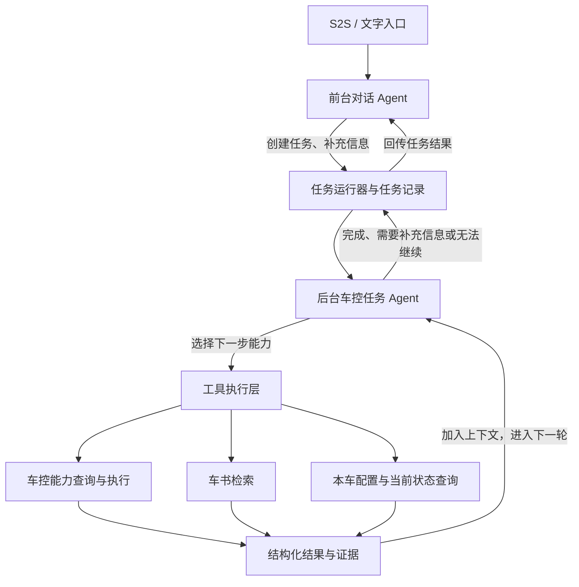

# 方案一：基于 LangChain 的车端个人 Agent Demo

日期：2026-11-13  
状态：作为方案一保留，尚未开始代码实现；其他方案另行讨论。

## 1. Demo 要验证什么

用户通过 S2S 实时语音或文字与前台 Agent 对话。前台理解需求，将任务交给对应的后台 Agent；后台自主调用能力，根据执行结果继续查询、判断和推进任务，最后向前台返回有依据的结果。

核心不是一次车控工具调用，而是完整的执行循环：

> 接收目标 → 选择能力 → 执行 → 观察结果 → 补充证据或调整方案 → 再次执行或结束。

车控失败后，后台应能自行查询车书、本车配置和当前状态，判断失败原因。不能把“没有找到控制工具”直接当成“这辆车不支持该功能”。

保持车机与手机共用个人 Agent 的长期方向，但首期集中验证前台派单、后台执行和失败后的自主查询，不展开完整的多租户、跨端同步和复杂编排系统。

## 2. 最小架构

建议先在同一个服务内实现一个前台对话 Agent、一个后台车控任务 Agent、一个任务运行器，以及三类工具。逻辑职责分开即可，不要求拆成多个服务。

| 部分 | 主要职责 |
| --- | --- |
| S2S / 文字入口 | 接收用户输入、呈现回复，复用相同的任务派发与后台能力 |
| 前台对话 Agent | 理解目标、派发任务、继续对话、转达后台问题和结果 |
| 后台车控任务 Agent | 根据目标与已有证据，决定查询、执行、委派、追问或结束 |
| 任务运行器 | 在后台驱动循环，保存任务和执行记录，处理等待、取消、超时与结果回传 |
| 工具执行层 | 提供工具定义，校验参数，调用实际或模拟能力，返回结果 |

首期只有一个后台车控 Agent 时，派发目标可以固定。后续增加其他领域 Agent，再扩展派发规则。

车书和车况先作为工具接入即可。若后续确实需要专门的子 Agent，可将“委派给子 Agent”包装成一种可调用能力，其结果仍回到当前任务的循环中。

## 3. 下一步判断是怎么产生的

每一轮模型调用都提供以下信息：

1. **任务目标**：用户想对哪辆车完成什么操作，以及已经明确的参数。
2. **执行规则**：根据证据判断，不把接口缺失等同于车辆不支持，不将查到操作说明等同于具备执行权限或接口。
3. **可用能力**：工具的名称、用途、参数定义和返回值含义。
4. **任务上下文**：之前调用过的工具、执行结果、失败原因和已获得的证据。

模型根据这些信息产生下一步工具调用，或者给出结束、追问的决定。运行器实际调用工具，将结果加入上下文，再次调用模型。

程序实现通用循环和确定性的执行边界。它不需要预先穷举所有“失败后查什么”的分支；但参数校验、操作许可、超时和停止条件由程序落实，不能只依赖模型自觉遵守。

评估重点是实际调用路径、证据和结论，不要求输出模型的内部思考过程。可对外展示简短活动记录，例如“正在核实本车配置”“已确认未配备空气悬架”。

## 4. 任务运行器的具体作用

任务运行器是一段普通后台程序，不是另一个模型，也不要求独立部署。

它承担以下工作：

- 创建并保存任务，记录用户目标、目标车辆和当前状态。
- 将执行放到后台，使前台不必一直等待模型或工具返回。
- 驱动模型调用与工具执行之间的循环。
- 保存执行记录，明确已经尝试过什么，避免无依据地重复尝试。
- 需要用户补充信息时暂停推进，收到回答后继续原任务。
- 处理取消、超时、步数上限，并把结果可靠地交回前台。

建议首期记录：任务标识、用户与车辆、目标、状态、工具调用记录和最终结果。状态可先采用待执行、执行中、等待用户、已完成、失败、已取消。

“已完成”表示任务已经得出最终结论，不一定表示车辆控制成功。例如，查证后确定本车没有空气悬架，也可以正常结束，但结果应明确为“不支持”，不能显示“调整成功”。

任务状态与最终结果需要持久化。若首期只使用进程内后台任务，服务重启后不会自然恢复执行；启动时至少应识别中断任务并说明状态。自动恢复尤其不能盲目重放执行结果未知的车控指令。

若所用 Agent 框架已经提供工具调用循环，直接复用，补齐任务记录、后台启动与结果回传即可。

## 5. 三类能力需要提供什么

| 能力 | 输入与返回的重点 |
| --- | --- |
| 车控 | 查询本车可调用的控制能力；接收明确操作与参数；返回受理、执行与效果确认信息 |
| 车书 | 按车型、配置适用范围和软件版本检索；返回相关说明、适用条件与出处 |
| 车辆信息 | 区分本车配置与当前状态；返回数据来源、采集时间，以及未知或不可用的说明 |

工具定义应包含名称、用途说明、参数 Schema 和结果语义。模型据此选择能力；工具层负责校验和转发。

失败结果不能只有“失败”两个字，至少应能区分：

- 未找到或未接入对应控制接口。
- 根据本车配置确认未配备该功能。
- 当前车辆状态不满足执行条件。
- 数据不足、查询不可用或信息冲突。
- 指令已发送，但是否执行成功尚不明确。

每项结论应附上实际获得的事实。无法确定的字段保留为未知，不由工具或模型补造。

## 6. 空气悬架示例

用户提出“调整空气悬架”。如果调整目标还不明确，后台可以先核实是否支持；实际下发前，需要明确用户要调到什么状态。

以下是一种可能的执行路径，用来说明预期行为，不要求模型固定按此顺序调用：

1. 前台将目标和车辆信息交给后台车控任务 Agent。
2. 后台查询可用控制能力，发现没有对应接口。
3. 后台查询本车配置，必要时检索匹配车型与版本的车书。
4. 根据证据区分以下情况，并继续推进或结束。

| 查证结果 | 后续行为 |
| --- | --- |
| 本车明确未配备空气悬架 | 结束任务，说明本车不支持，不下发调整指令 |
| 本车已配备，但助手没有可用控制接口 | 说明车辆具备功能，但当前助手无法执行；如提供手动操作说明，须有匹配车书依据 |
| 已配备且有接口，但当前条件不满足 | 查询并说明具体限制；不为了完成原任务擅自改变其他车辆条件 |
| 已配备、有接口、条件允许且目标明确 | 执行用户要求的调整，读取执行回执，必要时查询状态确认结果 |
| 数据不足或相互矛盾 | 继续有价值的查询，或明确无法确定；需要用户信息时发起追问 |

车书可能同时描述多个选配版本，因此“车书里介绍了空气悬架”不能单独证明当前这辆车装有空气悬架。

## 7. 前后台如何配合

前台创建任务后，可以告知用户正在处理，并继续承接其他对话。后台不依赖用户停留在当前一轮对话中。

后台只需向前台提交有意义的事件：需要用户补充信息、任务已有结果，或出现无法继续的问题。无需把每次工具调用都播报出来。

用户的补充信息必须关联回原任务。打断语音播报与取消后台任务是不同操作；用户明确取消任务时，运行器停止后续步骤，对已经发出的控制操作如实报告已知结果。

## 8. Demo 实现顺序与验收

建议按以下顺序实现，S2S 和文字最终复用同一套任务链路：

1. 定义三类工具和结构化返回结果，准备模拟车辆数据。
2. 跑通后台 Agent 的通用循环，验证它能根据结果改变下一步调用。
3. 加入任务记录、后台执行、追问与结果回传。
4. 用文字入口调试完整链路，再接入 S2S，验证语音入口下相同的任务行为。

上述顺序是实现建议，不代表取消 S2S 需求。Agent 框架已确定使用 LangChain；模型供应商和其余技术栈仍待确定。

至少验证四种模拟车辆场景：未配备、有配置但接口未接入、有接口但条件不满足、能力和条件均满足。

验收时重点观察：

- 控制能力缺失后，是否自主查询本车信息并按需查车书。
- 是否区分车辆不支持、接口未接入、条件不满足和信息未知。
- 是否能提供与结论对应的证据，而不是仅给出合理猜测。
- 能执行时是否真正调用控制能力并确认结果；模拟执行明确标注为模拟。
- 前台在后台执行期间是否仍能对话，追问是否能接续原任务。
- 无法推进、达到上限或用户取消时，是否正确停止并回传结果。

可以配置较小的最大步数和总时限，根据实际测试调整。相同调用连续返回相同结果时，应停止无意义的重复尝试。

## 9. 本阶段暂不展开

完整的多用户隔离、手机与车机状态同步、通用生活服务、多 Agent 层级编排和生产级任务调度留到后续。

当前必须保留的方向是：入口与任务执行分离，后台 Agent 持续拥有任务上下文，车控、车书和车辆信息具有清晰的能力边界，执行结果能回到前台形成闭环。

## 10. 技术选型记录

2026-11-13：用户确认使用 **LangChain** 作为 Agent 框架。

建议使用 LangChain 的 `create_agent` 实现后台工具调用循环，按需使用其底层 LangGraph 的 checkpoint 和暂停接续能力。模型负责根据证据选择下一步；框架负责驱动循环；应用自己的任务运行器负责后台启动、任务管理和结果回传。checkpoint 本身不等于后台调度或自动恢复服务。

其余选型保留为建议，尚未确认：

| 部分 | 建议 |
| --- | --- |
| 后端 | Python + FastAPI |
| 任务与执行状态保存 | SQLite 任务表与持久化 checkpoint |
| 车辆能力 | 普通工具函数、参数校验与模拟数据，后续替换为真实接口 |
| 模型 | 先评测中文理解、工具调用和结构化结果表现，再确定供应商与版本 |
| S2S | 独立适配实时语音服务，与文字入口共用后台任务链路 |

框架职责参考：[LangChain 官方架构分层说明](https://www.langchain.com/oss-overview)。具体依赖版本在实现时验证并固定。
