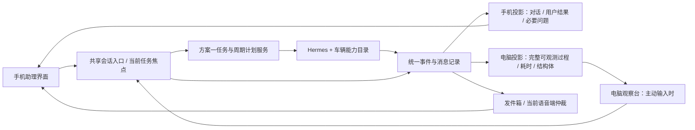

# 手机 Personal Assistant 与双端同步设计

日期：2026-11-15｜状态：手机网页、配对、双向消息、桌面过程观察与语音归属已实现；验证范围见[交付记录](mobile-sharing-acceptance.md)。

需求：[手机个人助理页面与电脑观察台](mobile-personal-assistant-requirements.md)。本设计复用方案一，不改变当前第15、16节的独立开发范围。

## 1. 页面定位和信息层级

手机提供专门的轻量助理界面；电脑保留当前详细观察台。不是把桌面页面压窄，也不是简单隐藏侧栏。

Muse的公开设计以主聊天为核心，活动、目标和可交互结果采用次级展示。[官方页面与设计说明](https://muse.ai/blog/how-we-designed-muse)

本项目建议的手机布局：

```text
┌────────────────────────────┐
│  助理头像  我的车辆助理    ⋯ │
│           正在处理 / 在线   │
│                            │
│                 用户消息   │
│  助理短回复                │
│  [主驾] [副驾] [全部]       │
│                            │
│  简洁结果 / 周期计划卡片    │
│                            │
│  [输入消息…] [语音] [发送]  │
└────────────────────────────┘
```

- 顶部：助理头像、名称、一行当前状态；点击头像或更多菜单进入活动与计划，不放工具配置。
- 中间：连续聊天，用户和助理气泡清楚分开；结果卡片直接嵌入对话。
- 底部：单一输入框、语音入口与发送；语音开启时突出倾听/处理中状态及停止按钮。
- 次级页面：进行中活动、周期计划、连接电脑、基础设置。活动只显示目标和状态，技术详情由电脑承担。

视觉建议：浅暖背景、低对比卡片、宽松留白、大圆角输入区、简洁气泡和轻量头像动效。避免仪表盘、多列布局、调试标签和高密度分隔。具体色值、字体与素材在视觉稿阶段确定；这里不声称来自 Muse 的官方设计令牌。

## 2. 关键状态

| 状态 | 手机 | 桌面 |
| --- | --- | --- |
| 空闲 | 头像及轻提示，可直接说话 | 当前会话和历史 |
| 正在倾听 | 明确的麦克风状态、停止入口 | 音频接收/转写过程；不默认镜像播放 |
| 已受理/处理中 | 一条简短状态，通常不逐步更新聊天气泡 | 目录检索、模型请求、工具参数、耗时 |
| 等待补充 | 一个问题及选项，五分钟期限用轻提示 | 问题归属、轮次与截止时间 |
| 改口/取消 | 一条明确反馈；旧结果卡片失效或标记已替代 | 修改事件、版本、停止与旧输出拦截 |
| 完成/失败 | 简短结果或原因，必要时附“重新发起” | 回执、引用证据、结果分类和JSON |
| 周期计划 | 频率、时间、下次执行、暂停/恢复/取消 | 计划定义、每次执行、跳过/错过原因 |
| 断线 | 清晰离线提示、保留输入、重连入口 | 设备连接状态和服务器任务进展 |

## 3. 双端架构



同一项任务只运行一次。两端读取同一份事实，展示不同投影。手机无需另起 Hermes，电脑也不重新执行手机指令。

## 4. 改造前的缺口与本次解决方向

| 当前实现 | 对双端同步的影响 | 后续所需改变 |
| --- | --- | --- |
| 浏览器通过本机Cookie创建会话 | 手机和电脑默认会成为两个独立会话 | 增加设备配对与共享 conversation 绑定 |
| 仅允许localhost等本机地址 | 手机无法直接访问电脑的回环地址 | 设计受控局域网/受信HTTPS接入，修改Host/Origin允许范围 |
| 部分聊天气泡只在页面内存中追加 | 电脑不能仅靠任务表还原手机全部对话 | 服务端记录用户文本、转写、助理最终回复和任务关联 |
| 任务事件已可查询/推送 | 可以复用过程、耗时与结构 | 统一事件序列，并增加移动/桌面两种投影 |
| 通知已有待播和已播标记 | 两个页面可能竞争播放/确认 | 区分阅读状态和播放确认，明确当前语音设备 |
| 一个会话限制一个语音连接 | 有助于避免重复播报，但缺少观察者角色 | 手机负责语音，桌面使用只读事件订阅；接管须显式操作 |

上述改造现已落实；旧版从未保存的闲聊/语音文本不能凭空还原，新版输入与可观测事件从接入后持续记录。

## 5. 设备配对与会话关联

Demo 使用电脑发起的一次性配对流程：电脑显示五分钟有效的12位配对码，手机打开受信任入口后完成绑定。绑定的对象是同一用户/共享会话，不向手机复制模型API Key。

每个设备保留自己的登录凭证和连接状态，服务端记录设备属于哪个共享会话、具有交互还是观察权限。配对码一次使用、短时有效，可解除设备。不能把永久会话Cookie直接写进二维码。

默认手机为主交互端、电脑为观察端。桌面看历史、展开工具详情不更新任务焦点；只有用户实际发送消息、选择任务并操作才更新焦点。

部署建议先按同一局域网 Demo 设计；公共互联网部署与账户体系需要后续单独确认。本次已提供显式配置的局域网HTTPS入口；不修改模型凭据、不安装系统证书信任或开机自启。

## 6. 共享消息与事件协议

已新增/扩展的记录（逻辑职责）：

| 记录 | 必需信息 |
| --- | --- |
| DeviceSession | 设备、共享会话、角色、配对状态 |
| ConversationMessage | 消息标识、会话、来源设备、角色、文本/转写、状态、关联任务、创建时间 |
| ConversationEvent | 服务端递增序列、事件类型、消息/任务/计划引用、任务版本、来源设备、观测时间 |
| DeliveryState | 通知标识、当前版本、已展示设备、负责播放的设备、播放状态与确认 |

用户输入携带幂等标识，重试不产生重复消息或任务。每个连接按自己的游标补收，不能让电脑“看过”就把手机待播消息消费掉。

服务端保存可观测动作和结果，不记录或展示模型隐藏的内部思维链。现有“处理过程”继续以工具事件和实测耗时解释。

消息流式片段可暂存；最终文本必须落为稳定消息。ASR临时转写与最终转写有区分，不把同一句话派发两次。显示原始转写与用户修正版本，便于电脑排查。

## 7. 手机与电脑的反馈同步

以“23度改21度”为例：

1. 手机提交请求，服务端写消息和任务事件，手机显示短反馈，电脑显示原话与接单记录。
2. Hermes检索/调用时，电脑逐步展示过程；手机只保留必要状态。
3. 手机改口，仍关联原任务；两端旧结果投影失效，电脑保留完整变更轨迹。
4. 新参数校验后，电脑展示21度结构；手机显示并在允许时播报21度的模拟结果。
5. 电脑收到事件不代表音频播完；手机实际播放确认后更新DeliveryState。

如果电脑也输入，服务端按事件顺序和任务版本处理；冲突时明确提示，不让设备凭本地缓存覆盖较新目标。

## 8. Personal Assistant 表达层

展示内容分为两层：

- 事实层：任务状态、已确认约束、实际回执、失败原因和计划规则，由程序维护。
- 表达层：将事实转成自然短句、问题选项或结果卡片；S2S根据这些事实生成语音。

不为每一步额外调用模型润色。常见状态优先模板；需要解释复杂查询时复用现有模型结论。手机文本与语音使用同一事实版本，避免一个显示21度、另一个仍播23度。

“Personal Assistant 感”来自正确承接、少打扰、知道什么时候追问与回来反馈，不靠虚构完成状态或增加拟人化承诺。

## 9. 语音与移动浏览器限制

手机浏览器麦克风通常需要受信任的安全上下文及用户授权；仅把本地地址换成电脑局域网IP不能保证可用。上线实施时应使用手机信任的HTTPS/WSS入口，并验证iOS Safari与Android Chrome。

一次会话默认只有一个音频输出端。手机正在通话时，桌面观察台只显示语音过程；需要桌面接管时显式切换，清理旧设备待播队列。

页面切后台、锁屏、网络切换时不能承诺持续录音或即时播放。后台任务由服务推进，手机回前台后补收状态。原生后台音频与系统推送不属于首版网页能力。

## 10. 已执行的实施顺序

1. 补共享消息/事件记录和设备配对，验证两端属于同一会话。
2. 保留桌面观察台，新增独立移动入口与两种事件投影。
3. 接入手机语音、播放归属、失效通知和重连同步。
4. 接入方案一的任务焦点、五分钟过期与周期计划卡片。
5. 验证“手机对话、电脑实时观察”的完整链，再做视觉细节与回复语气调整。

当前助理暂名“小伴”，使用本项目原创CSS头像；局域网HTTPS和设备配对已提供。方案一的任务执行能力继续复用。

## 11. 验收观察方法

同时打开手机入口与电脑观察台：手机完成一次追问、改口、取消、计划创建和暂停；电脑能够逐项对上原话、任务、工具、时间与最终结构。对断线重试、双端同时输入、旧音频晚到、刷新恢复分别做测试，不能以单端截图或模拟数据替代双端联调通过。

已完成手机/桌面独立浏览器、真实Hermes和千问接口验证。实体iOS/Android手机的证书信任、麦克风及系统后台行为需实机确认；不把Chrome手机视口测试当作真机验证。


## 12. 实现落点

- `app/device_sharing.py`：设备凭据哈希、短时配对码、重新绑定和撤销。
- `app/shared_messages.py`：权威消息、版本更新、游标补收、历史分页和可观测语音过程；不消费语音已播标记。
- `app/main.py`：同实例HTTP/HTTPS鉴权、共享消息/SSE、设备管理、单语音端及显式接管。
- `app/realtime.py`：用户转写和助理回复保存、语音过程同步、绑定失效后拒绝迟到输出。
- `web/mobile.*`：简洁移动投影；`web/app.js`：桌面完整过程及共享对话；`web/voice-client.js`：共用浏览器音频客户端。
- `scripts/configure_mobile_access.py` 与 `scripts/serve_web.py`：本地CA/服务器证书、同一个应用实例的HTTP与HTTPS入口。

手机和电脑并不是两个独立Agent。对话只派发一次，双方接收同一任务和消息版本；电脑查看数据不会抢焦点或启动麦克风。
