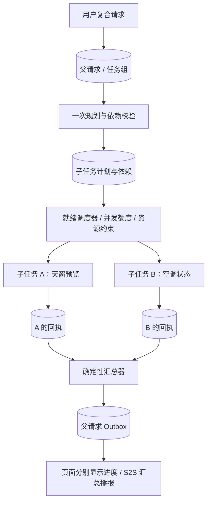

# 改造方案二：多任务拆分、并发执行与汇总

日期：2026-11-15  
状态：供评审的设计方案，尚未实现。本次只新增文档，不改代码或服务配置。当前以单实例 Demo 的功能与性能为范围，任务上下文、事件接续与反馈统一沿用 [方案一](demo-agent-loop-optimization-plan.md)。不以服务重启、跨节点接管或生产持久化为前置条件。

## 1. 对用户例子的结论

“把天窗打开一半，查看空调温度”可以拆成两个业务子任务：

| 子任务 | 目标 | 依赖 |
| --- | --- | --- |
| A | 生成天窗打开 50% 的控制结构 | 无 |
| B | 查询当前空调温度 | 无 |

两者处理不同资源、没有数据依赖，可以并发。用户仍看到一条原始请求及其两个子任务，最终得到一份合并结果，而不是两个互不关联、争着播报的聊天会话。

“先查温度，再增加一度”不能这样并行：控制参数依赖查询结果，应保留查询 → 控制的顺序。

本项目仍只生成车控预览、返回模拟查询；本文“控制完成”均指相应预览步骤完成，不声称设备已执行。

## 2. 当前为什么会顺序执行

目前一条复合指令整体创建一个 task，进入一个 Hermes 会话，由同一个 Agent 逐轮决定后续操作。`call_tools` 的批次在本地也是依次处理；用户提出的两个目标没有被应用层保存成两个独立可调度的子任务。

不同 task 已能创建独立 asyncio 工作，且本机 Hermes 的配置允许最多 3 个并行 run。这说明底层具备一定并发基础，但应用层还缺明确的拆分计划、依赖关系、资源冲突判断、父任务汇总和统一通知。

同一个 Hermes 会话的并发写入有串行化约束，因此不能仅给同一 session 同时 POST 两个 run 就期待真正并行。独立子任务应有各自的 Hermes session；回答追问或等待事件结束后，继续对应子任务的原会话。[Hermes API Server](https://hermes-agent.nousresearch.com/docs/user-guide/features/api-server)

## 3. 两层并发，分别处理

### 3.1 同一任务内部的并行工具调用

一次模型回复可以提出多个互不依赖的查询。若工具适配器支持，可以并发执行，再一次把结果交回模型。

收益是减少独立外部 I/O 等待，不需要两个独立 Agent。当前模拟工具本身只需毫秒，改成本地并发的收益很小；SQLite 写事务仍应短且串行提交，不能为了表面并发增加写锁争用。

### 3.2 独立子任务的并行 Agent 执行——本次建议重点

对于多个可独立完成的用户目标，记录父子结构后，让多个 Hermes 会话并行推进。这样查询侧不必等待控制侧的多轮推理结束。

简单单目标继续现有轻路径，不强制先做一次“任务拆分模型调用”。

## 4. 推荐结构

父请求负责原始目标、子任务集合、依赖和汇总。子任务负责独立执行、追问、回执和继续处理。**一个用户请求可以对应两个任务，但不等于两条独立用户输入。**

建议第一版一条复合请求最多拆成 4 个子任务，默认最多并行 2 个子任务；总额度同时受 Hermes 配置和提供方限制，不能把本机“最多 3 个 run”理解为永远可用的性能保证。

## 5. 谁拆分，何时拆分

推荐使用现有 Agent 的首次规划能力提出结构化计划，而不是用“逗号/然后”做字符串切割。

1. Inbox 先保存原输入，建立唯一父请求。
2. 明确单目标继续现有 task 轻路径；只有复合、独立目标候选才进入规划。候选判断只决定是否规划，不直接授权并发。
3. 规划运行只允许查看能力元数据及提交计划，尚不执行车辆操作。计划包含稳定 child_key、子目标、依赖、资源读写范围和完成条件。
4. 后台校验：子任务覆盖原需求、依赖无环、引用有效、数量受限、资源范围不超工具定义。语义覆盖仍需模型判断及评测；结构校验不能证明自然语言需求一定拆对。
5. 计划与子任务在同一事务提交。使用 `(parent_id, plan_version, child_key)` 唯一约束，重复提交同计划返回原子任务；同版本不同计划拒绝，不能在正常运行中因重复提交生成另一组孩子。
6. 规划运行退出并释放额度；后台调度独立子任务。父任务不持续占着一个模型轮询子任务进度。

为了避免“规划器其实已经控制过一次，再把相同目标交给子任务”的重复，规划阶段和执行阶段的工具权限要在运行层分开。模型文字说明不能代替这个限制。

这会给复合请求增加规划开销，所以“拆成两个 Agent”不一定比“同一轮批量调用两个快工具”更快。上线前必须与单 Agent 批处理对照，而不是默认所有含两个动作的句子都拆分。

## 6. 并发与串行判定

| 情况 | 默认策略 |
| --- | --- |
| 两个不同资源的独立查询 | 可并行 |
| 天窗设置 + 当前空调温度查询 | 可并行 |
| 空调设为 23℃ + 查询设置后的温度 | 串行，查询依赖控制完成/回执 |
| 先读当前温度 + 增加一度 | 串行，第二步依赖读数 |
| 同一资源两个写操作 | 串行或要求明确先后，不按完成快慢决定覆盖顺序 |
| 一个写操作 + 同资源状态查询，用户没说明要哪个时点 | 澄清或保守串行，并说明查询时点 |
| 全车状态查询 + 某个子资源写入 | 广域读取与子资源写入视为冲突，不能仅按工具 ID 不同判并行 |
| “如果 A 失败才执行 B” | 条件依赖，不预先执行 B |
| 不知道是否有关联/适配器不支持并发 | 默认串行，不赌独立性 |

建议在工具配置中增加可选执行元数据：资源域、读写性质、可并行性、幂等/重试能力、状态数据有效期。缺失这些元数据的工具默认保守处理。资源域须有层级与重叠规则，例如全车读取覆盖空调/车窗，而不能只用字符串相等。

Demo 中“设置后查询”只验证执行依赖；控制预览不会改变模拟 profile，不能据此假设查询值已经变为目标温度。

模型可以提出依赖，服务端最终按配置和任务依赖图限制并发。若候选工具可能触达的资源仍不确定，先缩小能力范围或推迟执行；不能只因两个自然语言子目标看起来不同就忽略实际工具资源。

## 7. 任务状态与最终汇总

父状态由子状态和原请求条件确定，不以“最后一个返回的子任务”代表整体：

| 子任务情况 | 父请求行为 |
| --- | --- |
| 所有必需子任务成功 | 标记整体完成；一份最终汇总 |
| A 成功，B 明确失败/不支持 | 部分完成，明确列出成功和未完成项 |
| 一个子任务等待用户 | 父请求等待补充；其他独立子任务继续，不能误报整体成功 |
| 一个子任务结果未知 | 父请求待核对；保留已完成结果，不将未知当失败或成功 |
| 用户取消父请求 | 取消尚未开始的子任务，撤销运行子任务执行权并停止远端；已完成结果保留，不声称已撤回 |
| 用户只取消某个子任务 | 记录范围变化，重新判断父请求完成条件，不无条件取消其他任务 |

查询＋控制的结果分类由程序按有效回执汇总，延续现有自动分类机制。不能为汇总类型再问一次模型。

页面实时展示每个子任务的进度与用时。默认 S2S 只播报一条父请求最终汇总；子任务完成更新页面，不各自插播“成功”。需要追问时可以单独询问对应子任务，但追问不等于父任务完成。

最终摘要优先用确定性模板合并业务结果；需要更自然的表述可由现有 S2S 完成，不另起一个后台总结模型来轮询或重复判断成功。

## 8. 多任务下如何接回原任务

“天窗 A 已完成，空调 B 问哪个分区”时，用户回答“全部”必须关联：

`parent_id → child_task_id=B → question_id → task_revision`

- 只有一个开放问题时可自动关联，仍把明确绑定写入 Inbox。
- 同时有两个开放问题且回答有歧义时，让用户选择，不能仅取最新任务。
- 答案只继续 B；A 不重跑，原始父目标不变。
- 页面重新打开时，沿用已有任务记录展示待答关系。
- 用户明确另起任务时建立新的父请求，而不是把新目标塞给 B。

因此当前“唯一待答任务自动关联”的 UI 要扩展为“唯一待答子任务关联”，但不要退回按关键词“全部”进行猜测。

## 9. 并发任务如何继续，以及怎样避免重复反馈

本轮只考虑单实例 Demo 正常运行期间的功能：

1. 一次请求确定一份父计划，记录 child_key 与依赖；重复事件不生成第二组子任务。
2. 每个子任务独立保留原目标、已知事实、问题、结果及 Hermes 会话。
3. A 已完成、B 等待回答时，回答只交回 B，A 不重新执行。
4. A、B 同时完成时，由程序按当前子任务集合汇总一次，不分别宣布整个父目标成功。
5. 用户取消父任务时，停止未完成子任务；已生成的预览仍如实显示。普通插话不触发取消。
6. 用户补充信息或时间事件到来时，只唤醒对应的待续子任务；不重新拆分整条请求。

例如天窗 A 已生成预览，空调 B 需要用户确认分区：前台展示 A 已完成，等待用户回答 B；回答“全部”后只继续空调任务，最终合并反馈。

不在这份 Demo 方案中处理进程退出、节点接管、投递 ACK 丢失或真实设备的执行去重。

## 10. 并发对耗时的实际影响

顺序执行约为：`规划/发现 + A 耗时 + B 耗时 + 汇总/播报`。

并发执行约为：`拆分与校验 + max(A, B) + 调度/汇总/播报`。

这是说明依赖关系的估算式，不是性能承诺。子任务各自可能需要工具发现和模型调用；增加上下文、提供方排队、限流及资源锁，都可能抵消收益。尤其当前模拟工具只有毫秒级，主要看能否重叠模型等待，而不是本地函数是否换成并行执行。

建议对照三个方案：

| 方案 | 用途 |
| --- | --- |
| 单 Agent 顺序处理 | 当前基线 |
| 单 Agent 批量提出独立工具调用 | 无额外拆分模型成本，适合非常短的工具组合 |
| 父计划 + 两个并发子 Agent | 适合各自需要多轮查证、可以独立推进的目标 |

比较最终正确率、是否多做/漏做操作、总模型请求与 token、端到端耗时和重复通知数。保留简单指令的单轮路径，不能拿所有请求都拆分换取某个复合样本更快。

## 11. 分阶段落地建议

**第一步：统一运行期任务接口。** 复用方案一的 TaskContext、事件入口、追问/等待/继续及反馈规则；不要为了并发增加一套重复的任务逻辑。

**第二步：固定例子验证父子协议。** 用明确的“天窗开一半＋查空调温度”验证两个子任务、独立会话、并行等待和一份汇总。测试计划可显式给定，不假装已具备通用拆分能力。

**第三步：开放结构化拆分。** 复用现有 Agent 提出计划，加入资源元数据和依赖校验；单目标绕过规划。限制拆分数量，禁止未经记录的运行中重规划。

**第四步：交互与性能验收。** 测 A 完成/B 等待用户、两个任务同时追问、取消与完成交错，以及是否只合并播报一次；对照三种执行方式的正确率、轮次和耗时。

本机推荐默认子任务并发 2、全局不超过实际 Hermes/提供方额度。后续是否提高应依据压测，不更改为无限并发。

## 12. 必须通过的验收

- 用户输入一次组合指令，只创建一个父请求和预期的两个子任务。
- A、B 的执行区间确实重叠；不能只看两个 UI 转圈就认为并发。
- 天窗生成 50% 预览，空调返回模拟温度；父结果引用两份真实回执。
- 不依赖当前温度的天窗任务不等待空调查询。
- “查温度后加一度”不能被错误拆成并发读写。
- A 已完成、B 等待回答时，只继续 B，不重新执行 A。
- 两个子任务同时完成只产生一条父最终通知。
- 一个任务失败时保留另一个的成功结果，并明确部分完成。
- 两个问题同时等待时，“全部”不会被随意送给其中一个。
- 父取消不造成迟到成功覆盖；已发生效果如实保留。
- 子任务受到限流时遵守 Demo 的并发额度与次数限制，不无限重试。
- 明确简单指令的轮次和耗时不因增加父子框架而无条件增加。

## 13. 与方案一的关系

方案一完善单任务的 Agent Loop 功能及效率；本方案增加多个独立任务的并发与汇总。可以在统一任务接口形成后接入并发验证，不需要先完成生产级恢复、共享存储或多实例部署。
