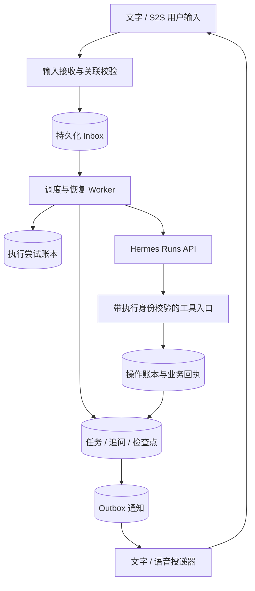

# 历史参考：任务持久化与服务重启恢复

日期：2026-11-15  
状态：已退出当前 Demo 改造范围，尚未实现；保留作为后续生产阶段参考。当前方案一已改为 [Demo Agent Loop 功能与架构优化](demo-agent-loop-optimization-plan.md)。

下文保留旧版内容，仅作历史参考，不再作为当前方案二的依赖。当前工作范围和实现顺序以新版 Demo Agent Loop 方案及多任务方案为准。

## 1. 目标与推荐边界

保留 Hermes 的 Agent loop、现有车辆配置协议、参数校验及 S2S 前台，在外围补齐持久化事件、执行接管和可靠通知。

用户看到的是**原任务继续推进**，而不是重启后出现一条新的同名任务。恢复不是从头重发原指令，而是先核对已发生的事实，再推进剩余工作。

第一阶段继续使用本机 SQLite/WAL 和现有手动后台服务，不引入 Kafka、Redis、分布式编排平台或定时业务。恢复扫描是服务启动后及运行期间的内部机制，不等于操作系统开机自启。

范围与保证：

| 事项 | 第一阶段目标 |
| --- | --- |
| 服务/进程重启 | 任务、追问、已确认回执、待处理输入及通知保留；可接管或按规则恢复 |
| 模型计算中断 | 允许重新计算尚未完成的推理，不承诺模型调用永不重复 |
| 当前模拟车控 | 在同一个 SQLite 事务内保存结果与操作账本，重试返回已有结果 |
| 将来真实车控 | 必须增加设备侧幂等/命令查单能力；结果未知时不盲目重发 |
| 语音送达 | 防止系统自动重复播报；无法确认是否已播完时暂停自动重播，保留文字结果 |
| 磁盘丢失/机器损坏 | 不属于进程恢复保证，需另做一致性备份与恢复演练 |

本文借鉴文章的“事件触发短暂运行、状态跨运行保存、输入与输出分开管理”思路；以下表结构、状态机及恢复规则是针对本项目的设计建议，不是文章提供的现成实现。[Building always-on agents](https://claude.com/resources/articles/building-always-on-agents)

## 2. 现状：已经持久化什么，缺少什么

| 部分 | 当前实现 | 主要缺口 |
| --- | --- | --- |
| 任务数据 | `tasks` 保存目标、状态、追问历史、轮次、目录快照、结果和一个 `run_id` | 没有待调度状态、执行尝试历史、租约和恢复决策记录 |
| 用户输入 | 新任务有 `(session_id, request_key)` 唯一约束；回答检查任务及轮次 | 回答没有独立持久化事件幂等记录；提交成功但响应丢失时不能稳定重放原受理结果 |
| 调度 | `TaskManager.jobs` 保存进程内 asyncio 任务 | 数据提交后、启动协程前崩溃，或进程丢失时，没有可靠补调度者 |
| 重启 | 启动、关闭时把运行任务标为 `interrupted` | 不核对远端是否仍在跑，不自动接管；`interrupted` 当前被视为终态 |
| Hermes 关联 | 同一个业务任务使用固定 Hermes 会话；按任务及轮次生成提交幂等键 | 未保存每次提交的完整请求快照；恢复可能改变请求内容；同一业务轮次的重新执行缺少独立身份 |
| 业务调用 | `capability_calls` 按任务、轮次、模型 `call_id` 去重 | 模型换一个 `call_id` 会成为新调用；相对动作不能仅凭参数相同来判断是否重复 |
| 完成通知 | 完成结果与通知已同事务保存 | `spoken` 混合了播报确认、追问已处理等含义；发送中的状态主要在内存中 |
| S2S | 忙闲门控；新连接跳过旧通知；待答上下文静默恢复 | 播放确认没有稳定的通知/投递标识，无法完整处理播完后确认丢失、多连接或重启 |
| 并发 | 不同任务可启动不同后台运行，Web 进程有文件锁 | 文件锁不等于远端执行所有权；失去监控的旧 Hermes 运行仍可能产生迟到调用 |

依据：`app/store.py`、`app/hermes.py`、`app/main.py`、`app/capability_tools.py`、`app/realtime.py`、`web/app.js`。恢复扫描不能复用前台只取最近 100 个任务的列表接口，必须分页扫描数据库中全部待处理状态。

## 3. 推荐架构

逻辑上分开接收、调度、执行和投递；第一阶段可以仍在现有 Web 进程内运行 Worker，不必立即拆成多个部署服务。进程内唤醒信号只用于降低延迟，数据库中的待处理记录才是恢复依据。

模型请求、Hermes HTTP 请求、语音生成和外部设备调用均不得长时间占用 SQLite 写事务。数据库事务只处理短小的状态变更。

## 4. 标识与责任：哪些保持，哪些变化

| 标识 | 含义与生命周期 |
| --- | --- |
| `owner_id` | 业务所有者；与浏览器/S2S 连接分离。第一阶段明确限定为现有本机账户/有效会话，不能仅凭 task_id 访问任务；跨端登录另行设计 |
| `input_event_id` | 一次用户输入。网络重试保持相同值；同样一句“再加一度”若是用户再次主动说出，必须是新事件 |
| `task_id` | 用户的业务目标。追问回答、基础设施重启及执行恢复不改变它 |
| `task_revision` | 已接受的用户目标/约束版本；接受补充或改需求时递增，单纯重启不递增 |
| `question_id` | 一次已持久化追问。回答必须关联它和对应任务轮次，不能只按“最新一条问题”猜测 |
| `continuation_id` | 一段逻辑续办，例如初始处理、收到一次回答后的继续处理；同一续办的网络重试保持不变 |
| `execution_id` | 某次真正提交给 Hermes 的执行尝试。提交响应丢失后查单/原样重试不换 ID；确认旧执行结束后重新执行才生成新 ID |
| `hermes_session_id` | 后台对话历史身份。正常恢复/追问沿用；确实丢失时允许建立新的恢复会话，但仍映射原 task_id |
| `execution_epoch` | 当前被允许调用工具、更新业务结果的执行代数。启动替代执行或取消时更换，用于拒绝旧执行的迟到写入 |
| `operation_id` | 一次逻辑业务操作的稳定身份；不直接等于模型生成的 call_id |
| `notification_id` / `delivery_id` | 一条业务通知及一次渠道投递。网络重试不制造新的业务通知；用户明确重播可创建新投递尝试 |

**监控接管和业务重新执行必须区分。** 新 Worker 只是接管仍健康的 Hermes run 时，更新 Worker 租约，不更换该远端运行的 execution_epoch。只有替代、撤销执行时才改变执行代数。

## 5. 拟新增或扩展的数据

| 数据 | 最小字段与约束 |
| --- | --- |
| `inbox_events` | owner、source、source_event_id、payload_hash、事件类型、task/group/question 关联、状态、受理结果；唯一键 `(owner, source, source_event_id)` |
| `tasks` 扩展 | owner、业务状态、当前 continuation/execution、execution_epoch、持久化剩余预算/截止时间、恢复原因、result_version、可选 parent_task_id |
| `task_questions` | question_id、task_id、revision、问题、open/answered/superseded、answer_event_id；同一问题只接受一次有效回答 |
| `task_executions` | execution_id、continuation_id、epoch、Hermes 会话/run、提交幂等键、完整请求快照及 hash、认证作用域指纹、状态、时间、租约、重试次数 |
| `task_checkpoints` | 原目标、已确认补充、固定目录/profile、成功操作引用、待完成项、当前问题、观察数据的来源和时间；可先作为 task 的版本化 JSON 字段 |
| `task_operations` | operation_id、逻辑 step_ref、task/revision、工具与版本、规范参数、执行策略、状态、结果/错误、外部 command_id；唯一逻辑操作约束 |
| `operation_attempts` | operation_id 下的实际执行尝试、执行身份、发送阶段、外部幂等键、回执及未知状态；允许“一次操作、多次安全传输尝试” |
| `outbox_notifications` | task/group、revision、result_version、通知类型、固定业务内容、渠道策略；唯一业务通知键 |
| `notification_deliveries` | notification_id、渠道、delivery_id、connection/epoch、状态、生成响应关联、播放开始/完成确认及投递租约 |

同一任务版本最多保留一个开放追问；替换问题时先将旧 question_id 标为 superseded。输入关联阶段按 owner 短暂串行化，真正执行使用任务级租约，因此不会把所有独立子任务串成一条长队。

现有 `events` 保留为审计/页面过程流；不继续把它同时当作输入队列、执行事实和语音送达状态的唯一来源。检查点不保存模型内部推理，用结构化业务事实支持恢复。

## 6. 输入如何接回原任务

以“空调调到 23 度 → 哪个分区？→ 全部”为例：

1. 首次输入先在 Inbox 落库，建立任务 T 与首次续办 C1，事务提交后返回“已受理”。
2. Agent 提问时，在同一事务内保存问题 Q、任务状态 `awaiting_input` 和追问通知；退出本次执行，不持续占住模型。
3. 用户回复带 `input_event_id + task_id=T + question_id=Q + expected_revision`。文字 UI 自动关联唯一待答任务；多任务歧义先选择。S2S 从持久化待答信息取得同样的关联，不把“全部”当作新目标。
4. 输入接收事务先查询事件幂等记录。完全相同的重试返回原受理结果；同 ID 不同内容拒绝。**这一步先于当前问题状态校验**，避免回答已受理后重试被误判为新回答。
5. 对新事件校验 owner、Q 仍有效、轮次匹配；原子保存答案、关闭 Q、更新 T 的约束版本、建立 C2 并置为待调度。不得在此创建新的业务任务。
6. Worker 在同一个 Hermes 会话中运行 C2，携带原目标“23 度”、已确认分区及既有回执。响应丢失或服务重启后，仍从 C2 继续。同一任务上一段执行尚未确认结束时，先把回答持久化排队并核对旧 run，不能同时启动第二个有写权限的执行。

来源去重不能只用模型的 function-call ID：同一用户输入可能被前台重复转成不同调用。应由可信入口绑定用户输入事件与工具调用；后台通知事件不能成为创建新用户任务的来源。确需一条输入拆多任务时，使用方案二中的稳定子序号。

身份限制：MVP 的 owner 映射先沿用现有会话隔离域，不自动合并不同 cookie 的历史任务。当前浏览器 cookie 只保留七天。MVP 可保证持有有效本机会话时恢复；cookie 丢失不代表任务丢失，也不能按任意 task_id 越权找回。跨车机/手机稳定身份需要后续认证绑定，不能假定现有 cookie 就是跨端用户身份。

## 7. 重启后恢复算法

启动时不再把全部运行任务直接写成终态 `interrupted`。先进入恢复扫描，按任务级租约逐个处理：

| 本地与远端情况 | 恢复动作 |
| --- | --- |
| 输入已入库，尚未调度 | 领取原事件，创建/取得原 continuation，不新增任务 |
| 用户回答已提交，Worker 还没启动 | 从原回答事件及 continuation 接着调度；不重复追加 history |
| 任务在等待用户 | 保留同一个 question_id；重建页面/语音上下文，等待回答，不重跑已完成步骤 |
| 已保存提交请求，但不知道是否发出/收到 run_id | 在幂等范围仍可靠时，用相同键、相同请求快照查回原 run；不得临时重组 input 或换新键重发 |
| Hermes run 仍在 queued/running | 仅接管监控、事件订阅和投递，不再创建 run；旧 Worker 不再拥有状态更新权限 |
| 本地已提交合法最终结果 | 业务任务保持完成，只处理通知；远端若仍在收尾，则终止/抑制多余工作 |
| 远端 completed，本地没有合法完成回执 | 核对持久化业务回执；不能凭 Hermes 最终文字宣布成功。若证据足够则重建结果，否则进入待核对或专门的收尾续办 |
| 远端 interrupted，操作账本没有未知外部效果 | 保留 task/continuation，撤销旧执行代数；在原会话里建立新的 execution，携带检查点推进剩余工作 |
| 远端 unknown | 进入 `needs_reconciliation`；先核对操作账本和远端所有权，再使用平台支持的未知状态处理流程。处理 unknown 不等于重放原操作 |
| 远端查不到、幂等记录过期、认证作用域变更 | 视为执行状态不明，不凭 404 新建运行；核对后才选择恢复或人工处理 |
| 明确取消、过期或最终失败 | 不自动恢复；取消先撤销执行权，再尽力停止远端。显式用户重试是新的授权事件 |

Hermes 的 Runs 接口支持持久化幂等重试，但有保留期和作用域限制；相同键改变请求会冲突。其重启后可能出现 `interrupted` 或需要专门处理的 `unknown`，不能一概当成失败后重跑。[Hermes API Server](https://hermes-agent.nousresearch.com/docs/user-guide/features/api-server)

本次只读能力检查确认本机声明支持运行提交、停止和未知状态处理。尚未做重启故障注入；实施前必须验证实际版本、24 小时保留窗口及 `resolve-unknown` 的边界，不能以文档描述代替实测。

### 执行快照和会话恢复

- 发出请求之前，持久化提交幂等键、精确 JSON 请求及 hash。相同尝试重试使用快照，不能重新预加载工具、改变已知结果或更新提示词后仍沿用旧键。
- 基础设施重试与用户新回答使用不同 continuation；否则旧终态的幂等返回会被误当成一次新的执行。
- Hermes 历史可用时沿用原 session，避免同时注入一份互相矛盾的手工 transcript。
- 历史确实不可用时，先确认旧运行不会继续提交业务效果，再建立恢复会话，传入结构化检查点；明确记录降级恢复。未记录的细节不自行补造。
- 真实状态查询要按工具策略检查有效期；缓存命中不等于状态仍新鲜。查询“设置后的温度”不能复用同一接口在设置前的读数，即使尚在 TTL 内；缓存键/失效条件还必须考虑资源写入和依赖步骤。模拟 profile 在固定快照内可复用，但生成控制预览不会改变模拟温度，不能把旧快照伪装成设备动作后的状态。
- 持久化截止时间、已用预算、重试次数和下一次重试时间。服务重启不刷新预算；新的有效用户补充可按规则开启新的续办预算。无变化的故障不得无限重启或反复通知。

### 阻止旧执行继续写入

任务租约只解决“谁管理任务”，execution_epoch 解决“哪个远端执行有权产生新的业务效果”。所有写操作、完成与追问都检查 task_revision 和 execution_epoch。

执行身份应由可信适配层在提交/启动时绑定，不能仅信任模型填写的 epoch，也不能让旧执行在每次调用时读取并冒用最新 epoch。当前 MCP 仅有 task_id/revision，不足以完成这项保证；必须验证 Hermes 运行上下文到工具适配器的绑定方式。

在该绑定未验证前，不开启同任务旧执行尚未收敛时的自动替代执行。需要停止/核对旧 run；跨接管的延迟回执可以保留为待核对事实，但不能直接覆盖任务状态。

## 8. 避免重复调用：分四层处理

| 层次 | 去重依据 | 防止的重复 |
| --- | --- | --- |
| 用户输入 | owner + source_event_id + payload_hash | 重复提交产生第二个任务、同一回答追加两次 |
| Hermes 提交 | 持久化 execution_id、提交键、精确请求快照 | POST 响应丢失后重复创建 run |
| 逻辑业务操作 | 服务端 operation_id / step_ref | 恢复后模型换了 call_id，重新提出已经完成的动作 |
| 设备下发 | 设备/适配层可查询的 command_id 和幂等键 | 外部请求已经生效，但本地没来得及保存回执 |

operation_id 的分配不能只写成“参数取 hash”：

- 首次执行前先登记逻辑步骤，由服务端分配 operation_id；模型的一个或多个 call_id 只是传输尝试的别名。对 MVP 已明确的单步操作，可在接收首个合法调用的本地事务中完成登记，不为分配 ID 增加一轮模型请求。
- 恢复上下文包含已有步骤与 operation_id；同一步使用相同 operation_id，完成后直接返回原回执。恢复模式下，已有未决或成功的写操作时，缺少 step_ref 的调用不得仅因 call_id 不同就新建写步骤：能确定对应原步骤则复用，不能确定则进入待核对。
- 参数、工具版本、目标设备与操作身份不一致时拒绝复用同 ID。
- 同任务中确实需要连续执行两次相同动作时，必须有两个明确的持久化 step_ref/次序；不能把它们合并，也不能让模型靠随机换 ID 绕过去重。
- 无法判断新调用是重试还是一个新动作时，不猜测；当前预览阶段可要求澄清，真实写操作必须暂停核对。

操作建议分为 `planned → dispatching → succeeded/failed/unknown`。先落库再执行，结果确认后落库；不得因进程重启把 dispatching 直接改成“未执行”。

**当前 Demo** 的模拟预览和回执可在同一事务完成，从而做到提交后重取原结果。**真实设备** 与本地数据库无法组成一个普通 SQLite 原子事务，必须依赖设备查单/幂等支持；没有这些能力时选择“未知不自动重发”，不能宣称端到端 exactly-once。

### “加一度”最需要防止的错误

原始状态 22℃，已确定本次目标为 23℃。计划中持久化本次目标、依据的状态版本和操作身份。

如果下发后进程中断，恢复时先核对这个操作，而不是把当前 23℃再理解为“还需要加一度”，重新算出 24℃。只看到当前温度为 23℃也不能证明原命令由本任务执行成功；可记录目标已满足的观察，但不能凭此伪造下发回执。是否直接结束应按任务/设备协议定义。

## 9. 避免重复播报：把结果、通知、播放分开

### 持久化与去重

1. 任务最终结果、result_version 和 Outbox 通知同事务提交。完成通知的语义去重键由 owner、task/group、revision、result_version、kind 组成；追问通知用 owner、question_id、kind，不能把不同追问合并。
2. 一项任务同一结果版本只生成一条完成通知；状态监控恢复、模型重复提交结论不能新增通知。
3. 文字与语音有独立 delivery 状态，页面看过不等于语音播过；追问被回答也不等于“已播音”。
4. 页面用 notification_id 更新同一条结果，不每次连接追加一条相同气泡。新结果版本替代旧版本时，旧版尚未投递通知标为 superseded；已投递的历史保留，但不再自动补播。
5. 每次语音投递有 delivery_id，关联 Qwen response、浏览器连接及播放确认。发送成功、音频生成完成和播放器报告结束是不同阶段。

建议渠道状态：`pending / claimed / generating / playing / played / interrupted / unknown / held / suppressed`。claim 使用投递租约；确认必须校验 owner、notification_id、delivery_id 和连接代次。迟到确认不能确认另一条通知。

浏览器保存已播放标识并可重发同一完成确认；服务端收到确认后持久化。可利用本地持久化存储保留标识，但不因此保存原始麦克风音频。

### 默认重连策略

保留用户已经明确的体验：**开启 S2S 不自动播报历史成功任务。**

- 新连接静默同步待答任务和状态；旧终态结果只在文字界面可见。
- 连接建立时订阅尚未完成的任务；之后产生的新完成结果可正常通知。
- 断开期间已产生的结果保留为文字通知，默认不在下一次开启语音时补播；用户可主动重播。
- 完全未开始播放的当前通知，等待空闲后投递。
- 已经开始播放但确认丢失时，标记 unknown，不自动从头重播；展示可重播入口。
- 明确被用户打断的播报记录 interrupted，不影响业务任务。推荐默认由用户选择继续/重播；若以后提供自动续播开关，必须沿用同一 notification_id，不能生成第二条业务通知。

最后一条比当前“同连接被打断后可自动重播”更保守，是本方案建议的产品调整，实施时需一并验收。

**不能同时保证绝不漏播和绝不重播。** 播完但 ACK 丢失是不可消除的歧义窗口。此场景建议优先避免自动重复播报，允许文字兜底及主动重播；播放器确认也不代表能够证明用户实际听到了。

## 10. 取消、并发与重启交叉时的规则

- 用户取消是持久化输入事件，先更新任务及撤销执行权，再请求远端停止。
- 新执行不能因旧 Worker 的延迟返回而覆盖取消状态；已发送的真实设备动作不能承诺撤回。
- 同一 task/revision 同时只有一个有效业务执行；监控租约接管不等于重复运行。
- 不同独立子任务可并发，详见[第二份方案](multi-task-concurrency-plan.md)。每个子任务独立使用上述恢复协议。
- 内部恢复轮询、后台状态刷新不会生成新的用户任务，也不能触发旧成功播报。

### 建议的初始运行参数

只作为实施起点：入库后立即唤醒 Worker，另以约 1 秒周期补扫遗漏；Worker 每 5 秒续租，租约约 20 秒；同一续办自动恢复最多 3 次，并沿用持久化截止时间。重启时尽快显示“恢复中”，不把等待租约或核对远端的时间伪装成模型思考。

正常关闭先停止领取新执行、保存检查点并释放监控租约；仅 Web 关闭不应默认取消仍健康的 Hermes 运行。恢复的实际时延、重试次数和预算应通过故障测试调整，不能靠不断重启重置。

## 11. 实施顺序与迁移

**P0：先验证外部边界。** 用隔离测试环境确认 Hermes 幂等重放、请求冲突、重启 unknown、原 session 历史恢复及工具执行身份绑定。此次方案编写没有执行这些故障测试。

**P1：输入和任务接续持久化。** 增加 Inbox/Question/Continuation，做到受理后即使协程未启动也能恢复；完善重复回答、过期回答和多待答任务选择。

**P2：执行账本与恢复接管。** 保存原始提交快照，区分监控接管和重新执行，增加租约/执行代数。先对只读和模拟工具开启自动恢复。

**P3：通知投递账本。** 分离结果与渠道状态，增加投递身份、播放确认、未知状态及静默重连策略。

**P4：故障注入验收后再开放并发父子任务。** 不先把多任务一起自动恢复，再补去重。

迁移只向前：保留已有任务 ID、目录快照和历史。旧 `interrupted` 不批量自动重跑，标记为旧记录待评估；旧 `spoken` 不能推断精确播放状态，迁移后不自动补播旧通知。新增表与旧代码切换需版本检查，恢复开关可先关闭做只读核对；回滚旧版服务时必须避免两个调度器同时接管。

运行所需数据目录与 Hermes 状态目录都要持久保留。备份应使用一致性快照/SQLite 备份方式，而非运行中随意复制一个主数据库文件；恢复旧备份后也不能凭落后的账本重发外部操作。

## 12. 验收用例

| 故障/输入 | 必须观察到的结果 |
| --- | --- |
| task 与 Inbox 提交后、Worker 启动前退出 | 原 task 被领取一次，无第二条同名任务 |
| 回答“全部”提交后响应丢失，客户端重试 | 原问题只关闭一次，history 只追加一次，仍是原温度目标 |
| 两个客户端同时回答同一个问题 | 一个回答生效；另一个明确冲突，不悄悄覆盖 |
| POST Hermes 已受理但 run_id 未保存 | 原样重试找回原 run，不新增执行 |
| Web 重启，Hermes 仍在运行 | 只重新监控原 run，操作调用次数不增加 |
| Hermes 重启返回 unknown | 核对/解除未知状态后再决定续办，不自动重放 |
| 模拟操作提交后、工具响应丢失 | 同 operation 取得同一回执，不重复生成副作用 |
| 将来设备已执行、回执丢失 | 查单或保持待核对，不再盲发“加一度” |
| 已完成结果入库，语音还没发出 | 业务结果不丢；按当前语音订阅策略投递或静默保留 |
| 已播完但确认丢失，随后重启 | 不自动再播；文字可见、可主动重播 |
| 开启语音但没有新指令/新结果 | 没有历史成功播报 |
| 用户取消后旧执行返回结果 | 任务仍取消，迟到结果不覆盖当前状态 |
| 目录更新后恢复旧任务 | 继续固定版本，或明确声明版本不可用；不静默换 Schema |
| 超过保留期/凭据作用域变化 | 不拿旧幂等假设换键重发，进入核对流程 |

验收指标包括逻辑任务数、有效操作数、执行尝试数、通知数及实际投递状态，而不仅是最终文字是否“成功”。应分别杀掉 Web、Worker、Hermes，以及模拟发送前后/提交前后的中断窗口。
